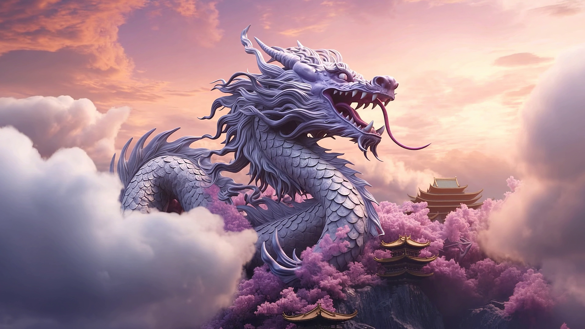

# Modern Dragon

Dark [Omarchy](https://omarchy.org/) theme built on the Sakurazuki palette, featuring a 4K dragon wallpaper and a seamless silent 4K video intro powered by Omarchy's wallpaper engine (`owe`).



## Installation

Run the following command in your terminal to install and immediately activate **Modern Dragon**:

```bash
omarchy theme install https://github.com/tedsummers/omarchy-modern-dragon-theme.git
```

To switch back to **Modern Dragon** at any time from the CLI (or pick **Modern Dragon** from the Omarchy Theme Switcher):

```bash
omarchy theme set "Modern Dragon"
```

## Features

- **Seamless 4K Intro → Still Handoff**: Selecting the theme (or logging in) plays `backgrounds/intros/JSD.mp4` (`3840×2160`, silent) and settles pixel-for-pixel onto the matching 4K still `backgrounds/JSD.png` with zero visual jump.
- **Sakurazuki Color Palette**: Near-black plum base (`#14111a`), muted sakura-rose accents (`#a87692`), and moonlit lavender foreground (`#d8d0dc`).
- **Full Desktop Coverage**: Declarative `colors.toml` + themed configurations for Omarchy Shell, Hyprland, Alacritty/Foot/Ghostty/Kitty, Neovim, Helix, GTK 3/4, btop, Mako, SwayOSD, Hyprlock, and Chromium.

## Palette

| Role | Hex |
| :--- | :--- |
| Background | `#14111a` |
| Foreground | `#d8d0dc` |
| Accent | `#a87692` |
| Selection | `#d8d0dc` |
| Rose (`color1` / `color9`) | `#8d5f74` / `#b57a92` |
| Slate (`color2` / `color10`) | `#6f7b8f` / `#8791ae` |
| Violet (`color3` / `color11`) | `#9a84a2` / `#bea2c7` |
| Magenta (`color5` / `color13`) | `#947598` / `#c3a5ca` |
| Moonlit Blue (`color6` / `color14`) | `#7e95c1` / `#94abd1` |
